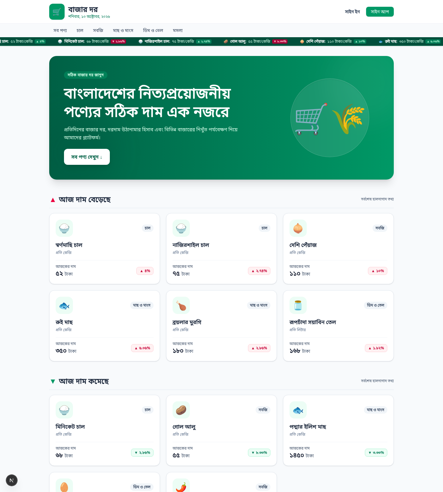

<div align="center">

# 🛒 বাজার দর — BazarDor

**বাংলাদেশের নিত্যপ্রয়োজনীয় পণ্যের দৈনিক বাজার দর এক নজরে**

Next.js 16 · React 19 · TypeScript · Tailwind CSS 4 · DaisyUI · Better Auth

[🔗 Live Site](https://bazar-dor-pied.vercel.app) · [💻 Repository](https://github.com/annoying-anna/B14-A7-Bazar-Dor)

</div>

---

## 📖 Project Description

**বাজার দর (BazarDor)** is a responsive price-tracking web application for everyday
goods in Bangladesh. It reads live product and category data from a public REST API,
shows today's **current price**, how the price **rose or fell** compared to the previous
period, the **lowest / highest / average** price of each product and the **price in each
market (বাজার)**. Visitors can browse by category, sort the list by price and search by
name, while authentication (email/password + social login) protects the product detail
page and the user profile.

The whole interface is written in Bengali with Bengali (১২৩) numerals and works on
mobile, tablet and desktop.

<p align="center">
  
</p>

---

## ✨ Key Features

1. **আজকের দাম ও দাম বাড়া-কমার ধারা** — the home page highlights the top 6 products whose price **rose (▲)** and the top 6 whose price **fell (▼)**, each card showing the emoji, name, unit, today's price in Bengali digits and a coloured change badge.
2. **ক্যাটাগরি অনুযায়ী ফিল্টার ও প্রাইস সর্টিং (C1)** — every category has its own page (`/category/[slug]`) with a `সাজান` dropdown: `ডিফল্ট`, `দাম: কম থেকে বেশি`, `দাম: বেশি থেকে কম`. Sorting uses the **numeric** value, so Bengali numerals sort correctly.
3. **প্রোটেক্টেড প্রোডাক্ট ডিটেইলস পেজ** — `/product/[slug]` needs a valid session. It shows the market summary, minimum / maximum / average price and a **বাজারভিত্তিক আজকের দাম** table. Guests are redirected to sign in and returned to the same product afterwards.
4. **Better Auth অথেন্টিকেশন** — real email + password **সাইন আপ / সাইন ইন** powered by Better Auth, plus **Google ও GitHub social login** buttons, a protected `/profile` route and toast notifications for every success or validation error.
5. **প্রোফাইল আপডেট (C3)** — `/profile` has a **তথ্য আপডেট করুন** button that opens `/profile/edit`, where the user changes their name through the Better Auth `updateUser` API and the Navbar + profile update instantly.
6. **Loading skeleton, 404 ও toast UX** — every data-driven page shows an animated skeleton while fetching, unknown routes render a friendly Bengali 404 with a **হোম পেজে ফিরে যান** button, and `react-hot-toast` reports auth events and protected-route redirects.
7. **Live price ticker + responsive design** — an infinite marquee under the navbar scrolls through product prices, and the layout, navbar, hero and product grids collapse correctly from desktop down to mobile.

---

## 🛠️ Technologies Used

| Technology | Purpose |
| --- | --- |
| **Next.js 16 (App Router)** | Routing, server components, route handlers, `proxy` route protection |
| **React 19** | UI, hooks, context, `use()` for async dynamic route params |
| **TypeScript** | End-to-end type safety |
| **Tailwind CSS 4 + DaisyUI 5** | Styling, responsive layout, consistent design system |
| **Better Auth** | Email/password authentication, Google & GitHub OAuth, sessions, `updateUser` |
| **PostgreSQL (`pg`)** | Optional persistent store for users and sessions |
| **react-hot-toast** | Success / error / validation toast notifications |
| **REST API** | `https://api.api-store.workers.dev/api/bazardor` (with automatic fallback endpoint) |

---

## 🗺️ Routes

| Route | Type | Description |
| --- | --- | --- |
| `/` | Public | Hero banner, price ticker, **আজ দাম বেড়েছে**, **আজ দাম কমেছে** and **সব পণ্য** with search + category filter |
| `/category/[slug]` | Public | Category products with the `সাজান` price sort dropdown and an empty/404 state |
| `/product/[slug]` | 🔒 Protected | Product summary, min/max/average price and বাজারভিত্তিক today's price table |
| `/signin` | Public | Better Auth email/password sign in + Google / GitHub social login |
| `/signup` | Public | Better Auth registration (name, email, password) |
| `/profile` | 🔒 Protected | Signed-in user information |
| `/profile/edit` | 🔒 Protected | Update the user's name (challenge C3) |
| `/api/auth/[...all]` | API | Better Auth catch-all handler |

---

## 🔐 Authentication (Better Auth)

* Server instance: `src/lib/auth.ts` — email/password (`autoSignIn: false`, minimum 8 characters), Google + GitHub social providers, `nextCookies` plugin.
* Route handler: `src/app/api/auth/[...all]/route.ts` (`toNextJsHandler`).
* Browser client: `src/lib/auth-client.ts` (`signIn.email`, `signUp.email`, `signIn.social`, `signOut`, `updateUser`).
* Session state: `src/context/AuthContext.tsx` wraps `authClient.useSession()`, so the Navbar, profile and product pages all read the **real** session.
* Protected routes: `src/proxy.ts` (Next.js 16's renamed middleware) redirects visitors without a session cookie to `/signin?redirect=…`, and each protected page validates the session again on the client.

### Sign up → sign in flow

1. The user registers on `/signup` with name, email and password.
2. Better Auth creates the account but does **not** sign the user in (`autoSignIn: false`), matching the assignment requirement.
3. A success toast is shown and the user is taken to `/signin`, where the new credentials are used to log in.

---

## ⚙️ Environment Variables

Copy `.env.example` to `.env.local` and fill in the values. The same keys must be added
in **Vercel → Project → Settings → Environment Variables** for the deployment.

| Variable | Required | Description |
| --- | --- | --- |
| `BETTER_AUTH_SECRET` | ✅ Production | Signs session tokens. Generate with `openssl rand -base64 32` |
| `BETTER_AUTH_URL` | ✅ Production | Public URL of the app, e.g. `https://bazar-dor-pied.vercel.app` |
| `DATABASE_URL` | Optional | PostgreSQL connection string. Without it Better Auth uses its built-in in-memory store |
| `GOOGLE_CLIENT_ID` / `GOOGLE_CLIENT_SECRET` | Optional | Enables the Google login button. Redirect URI: `<BETTER_AUTH_URL>/api/auth/callback/google` |
| `GITHUB_CLIENT_ID` / `GITHUB_CLIENT_SECRET` | Optional | Enables the GitHub login button. Callback URL: `<BETTER_AUTH_URL>/api/auth/callback/github` |

`NEXT_PUBLIC_BETTER_AUTH_URL` may optionally be set when the auth API is hosted on a
different origin — otherwise the client uses the current origin automatically.

> Social provider buttons are always visible; a provider only performs a real OAuth
> redirect once its credentials are configured, otherwise a helpful toast is shown.

---

## 🚀 Run Locally

```bash
# 1. Clone the repository
git clone https://github.com/annoying-anna/B14-A7-Bazar-Dor.git
cd B14-A7-Bazar-Dor

# 2. Install dependencies
npm install

# 3. Create the local environment file
cp .env.example .env.local   # then edit BETTER_AUTH_SECRET

# 4. Start the development server
npm run dev
```

Open [http://localhost:3000](http://localhost:3000).

### Useful commands

```bash
npm run lint       # ESLint
npx tsc --noEmit   # TypeScript check
npm run build      # production build
npm run start      # run the production build
```

---

## 📦 API

Base URL: `https://api.api-store.workers.dev/api/bazardor`
(automatic fallback: `https://api.abcz.workers.dev/api/bazardor`)

| Endpoint | Description |
| --- | --- |
| `GET /products` | All products |
| `GET /products?category=chal` | Products of one category |
| `GET /products/1` | A single product |
| `GET /categories` | All categories |
| `GET /categories/chal` | A single category |

`src/lib/api.ts` normalises the response into the internal `Product` / `Category`
shape, tries both base URLs and finally falls back to the bundled sample dataset if the
remote endpoints are temporarily unavailable (they are rate-limited from time to time),
so the UI always renders.

---

## ✅ Assignment Checklist

**Basic**

- [x] Works on mobile, tablet and desktop
- [x] 8+ meaningful Git commits
- [x] Deployed and error-free after deployment
- [x] README with name, description, technologies and 5+ features

**Main requirements**

- [x] Navbar with `🛒 বাজার দর` + Bangla date, category links (active link highlighted), auth buttons, and a price ticker marquee
- [x] Hero banner with eyebrow text, heading, subtitle, CTA anchor to `#সব-পণ্য` and an image
- [x] Home sections: top 6 risers, top 6 fallers and all products in a responsive grid
- [x] Product cards with emoji, name, unit, Bengali price and coloured change badge
- [x] Protected product detail page with min / max / average price and বাজারভিত্তিক table
- [x] Category page with sort control, loading skeleton and empty/404 state
- [x] Sign in / Sign up with Better Auth, social buttons and toast notifications
- [x] Figma-style footer
- [x] Responsive design
- [x] Friendly 404 page for unknown routes
- [x] Skeleton loading state while fetching
- [x] Toast for auth events and protected-route redirects
- [x] Dynamic `[slug]` routes work after a hard refresh on Vercel

**Challenge requirements**

- [x] **C1** `সাজান` sort dropdown (ডিফল্ট / দাম: কম থেকে বেশি / দাম: বেশি থেকে কম) sorting by numeric value
- [x] **C2** Well-designed README
- [x] **C3** Update information feature using the Better Auth `updateUser` API

---

## 👩‍💻 Author

**Annoying Anna** — Programming Hero, Batch 14 · Assignment 07

> সকল দাম সম্ভাব্য; বাজার অবস্থার ওপর নির্ভর করে পরিবর্তিত হয়।
